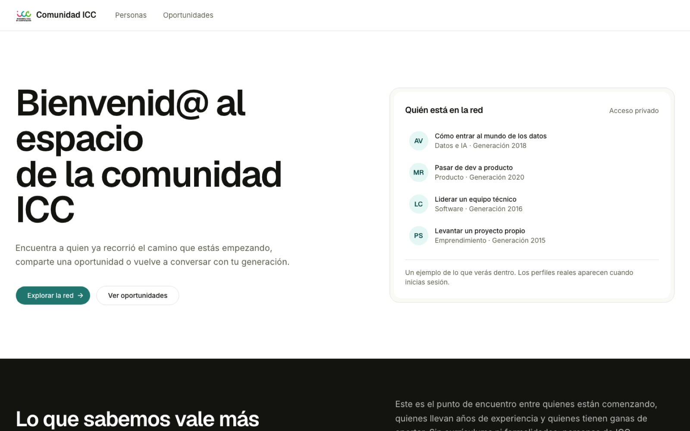

# Directorio Alumni ICC

Directorio privado para que estudiantes y exalumnos de Ingeniería Civil en Computación (Universidad de Talca) se encuentren, compartan oportunidades laborales y retomen contacto. Interfaz en español.

[](LICENSE)
[](https://directorio-alumni-icc.vercel.app)




El contenido del directorio solo se ve con sesión iniciada y acceso aprobado, por eso la demo pública muestra únicamente la portada. Este proyecto no es un sitio oficial ni está afiliado a la Universidad de Talca.

## Qué hace

- **Directorio de personas** (`/directorio`): búsqueda por nombre y filtros por área y generación. Cada perfil muestra cargo, empresa, ubicación, en qué puede ayudar y datos de contacto.
- **Acceso por verificación** (`/verificacion`): los correos `@alumnos.utalca.cl` con correo verificado entran como estudiantes de inmediato. Un exalumno envía nombre, generación y LinkedIn, y un administrador aprueba o rechaza la solicitud en `/admin`. El resultado se notifica por correo.
- **Perfiles de alumni** (`/perfil`): cada alumni edita su perfil, sube una foto (JPG, PNG o WebP, hasta 4 MB) y decide si se publica. Aparecer en la portada requiere un consentimiento aparte y una foto.
- **Contacto con privacidad**: el alumni elige mostrar su correo o mantenerlo privado. Si es privado, los estudiantes le escriben desde un formulario en la app y el mensaje (10 a 1200 caracteres) se reenvía por correo sin exponer la dirección.
- **Bolsa de oportunidades** (`/oportunidades`): los alumni publican empleos y prácticas (presencial, híbrido o remoto) con enlace de postulación o correo, y pueden cerrarlas.
- **Roles**: `student`, `alumni` y `admin`, tomados del public metadata de Clerk. Los estudiantes consultan el directorio; solo alumni y admins tienen perfil y publican ofertas.

## Stack y arquitectura

| Capa | Tecnología |
| --- | --- |
| Frontend | Next.js 16 (App Router), React 19, Tailwind CSS 4, shadcn/ui sobre Base UI |
| Autenticación | Clerk, integrado con Convex mediante JWT |
| Backend y base de datos | Convex (queries, mutations y actions) |
| Fotos | Vercel Blob (almacén público, rutas no adivinables) |
| Correo | Resend con plantillas de React Email |
| Errores | Sentry (opcional) |
| Hosting | Vercel |

Carpetas principales:

```text
app/          Rutas de Next.js: portada, directorio, oportunidades, perfil,
              verificacion, admin, sign-in/sign-up y api/profile-photo
components/   UI por área (directory, jobs, admin, landing, auth) y components/ui
convex/       Esquema, funciones del backend, correos y seed
convex/lib/   Reglas de dominio (roles, verificación, contacto, ofertas) con tests
lib/          Utilidades compartidas (taxonomía de áreas y generaciones, fotos)
proxy.ts      Middleware de Clerk: solo "/", "/sign-in" y "/sign-up" son públicas
```

## Correr localmente

Requisitos:

- Node.js 22 o superior (los tests usan `--experimental-strip-types`) y [pnpm](https://pnpm.io)
- Cuenta de [Convex](https://convex.dev) y una instancia de [Clerk](https://clerk.com) en modo desarrollo
- Opcional: [Resend](https://resend.com) para correos y un store de [Vercel Blob](https://vercel.com/docs/vercel-blob) para fotos

### 1. Instalar y configurar

```bash
pnpm install
cp .env.example .env.local   # completa las variables de la tabla
pnpm convex:dev              # crea o conecta tu deployment de Convex (déjalo corriendo)
pnpm dev                     # en otra terminal; abre http://localhost:3000
```

Usa siempre `http://localhost:3000` y no la IP de red, porque Clerk valida el origen.

### 2. Configurar Clerk

1. En Clerk, activa la integración con Convex. Así el token expone `email` y `emailVerified`.
2. En el JWT template `convex`, agrega el rol para poder distinguir administradores:

   ```json
   {
     "aud": "convex",
     "role": "{{user.public_metadata.role}}"
   }
   ```

3. Define las variables de Convex. Las actions leen `CLERK_SECRET_KEY` desde el backend de Convex, no desde `.env.local`, y debe ser la clave de la misma instancia de Clerk:

   ```bash
   npx convex env set CLERK_JWT_ISSUER_DOMAIN https://<tu-instancia>.clerk.accounts.dev
   npx convex env set CLERK_SECRET_KEY sk_test_...
   ```

4. Para entrar a `/admin`, pon `{ "role": "admin" }` en el public metadata de tu usuario en Clerk. Con `"alumni"` o `"student"` asignas esos roles directamente.

En una instancia de desarrollo de Clerk, los correos con sufijo `+clerk_test` (por ejemplo `alumni+clerk_test@example.com`) aceptan el código `424242` sin enviar un correo real.

### 3. Datos de prueba (opcional)

```bash
npx convex run seed:run
```

Crea perfiles de ejemplo con personas ficticias (correos `@alumni.example.com`), invitaciones y un perfil sin publicar. Es idempotente: si ya corrió, no duplica nada. Esos usuarios no pueden iniciar sesión; son solo contenido para el directorio. Inicia sesión con tu propia cuenta de Clerk para verlos.

### Variables de entorno

En `.env.local` (Next.js). `.env.example` también lista `CLERK_JWT_ISSUER_DOMAIN`, pero solo la lee Convex, así que va en la segunda tabla:

| Variable | Para qué | Requerida |
| --- | --- | --- |
| `NEXT_PUBLIC_CLERK_PUBLISHABLE_KEY` | Clave pública de Clerk | Sí |
| `CLERK_SECRET_KEY` | Clave secreta de Clerk | Sí |
| `NEXT_PUBLIC_CONVEX_URL` | URL de tu deployment de Convex (`https://….convex.cloud`) | Sí |
| `NEXT_PUBLIC_CLERK_SIGN_IN_URL` | Ruta de inicio de sesión (`/sign-in`) | Sí |
| `NEXT_PUBLIC_CLERK_SIGN_UP_URL` | Ruta de registro (`/sign-up`) | Sí |
| `BLOB_READ_WRITE_TOKEN` | Token de Vercel Blob para subir fotos de perfil | Solo para fotos |
| `NEXT_PUBLIC_SENTRY_DSN` | DSN de Sentry | No |

En Convex (`npx convex env set [--prod] NOMBRE valor`):

| Variable | Para qué | Requerida |
| --- | --- | --- |
| `CLERK_JWT_ISSUER_DOMAIN` | Dominio emisor de la instancia de Clerk de desarrollo | Sí |
| `CLERK_PRODUCTION_JWT_ISSUER_DOMAIN` | Dominio emisor de la instancia de producción | Solo en producción |
| `CLERK_SECRET_KEY` | Clave secreta de Clerk, usada por las actions | Sí |
| `RESEND_API_KEY` | Clave de Resend para enviar correos | Solo para correos |
| `RESEND_FROM` | Remitente verificado, por ejemplo `Red Alumni ICC <red@tu-dominio.cl>` | Solo para correos |
| `APP_URL` | URL pública de la app, usada en los enlaces de los correos | Solo para correos |

Sin Resend, la app funciona, pero no se envían las notificaciones de verificación ni los mensajes de estudiantes a alumni.

Para usar tu propio store de Vercel Blob, cambia `PROFILE_PHOTO_HOSTNAME` en `lib/profile-photo.ts` por el hostname de tu store. Esa constante valida que las fotos pertenezcan al usuario y configura `images.remotePatterns` en `next.config.ts`. Sentry funciona sin DSN (no reporta nada). Si lo usas, ajusta `org` y `project` en `next.config.ts`.

### Scripts

| Comando | Qué hace |
| --- | --- |
| `pnpm dev` | Servidor de desarrollo de Next.js |
| `pnpm convex:dev` | Backend de Convex en modo desarrollo |
| `pnpm build` / `pnpm start` | Build y servidor de producción |
| `pnpm test` | Tests unitarios de reglas de dominio (`convex/lib` y `lib`) |
| `pnpm typecheck` | Chequeo de tipos con TypeScript |
| `pnpm lint` | ESLint |
| `pnpm format` | Prettier sobre `.ts` y `.tsx` |

## Deploy

La app corre en Vercel, con Convex como backend y una instancia de producción de Clerk.

1. Despliega las funciones con `npx convex deploy`.
2. Define en Convex de producción las variables de la segunda tabla con `npx convex env set --prod ...`. `CLERK_SECRET_KEY` debe ser `sk_live_...`.
3. Importa el repositorio en Vercel y define las variables de la primera tabla. Si usas Vercel Blob, conecta el store al proyecto para que se inyecte el token.

No guardes claves en archivos versionados.

## Licencia

Código bajo licencia MIT. Úsalo como quieras, manteniendo el aviso de copyright. Ver [LICENSE](LICENSE).

## Autor

Hugo Castro, [github.com/HugoCL](https://github.com/HugoCL) · [hugocastro.dev](https://hugocastro.dev)
